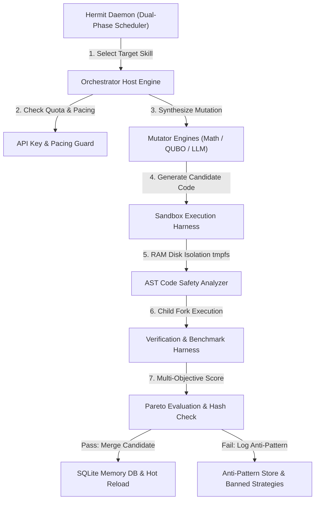

# Project Hermit - Autonomous Self-Evolving Code & Logic Engine

[](https://github.com/codebyangelo/project-hermit/actions/workflows/test.yml)
[](pyproject.toml)
[](https://www.python.org/)
[](LICENSE)
[](#human-ai-engineering--development-environment)

**Project Hermit** is a mobile-native, closed-loop autonomous self-optimization engine and dynamic Model Context Protocol (MCP) tool host. Operating as a background daemon, Hermit continuously discovers, profiles, refactors, and benchmarks Python algorithms inside isolated RAM-disk sandbox environments using LLM-guided synthesis combined with deterministic mathematical and AST mutators.

---

> [!NOTE]
> **Historical Archive & Provenance**: The original 19 developmental release iterations (`v0.0.1` through `v0.1.9`) and historical evolution reports generated during mobile development are permanently preserved in Git history under branch [`archive/v0.1.9`](https://github.com/codebyangelo/project-hermit/tree/archive/v0.1.9) and tag [`v0.1.9-archive`](https://github.com/codebyangelo/project-hermit/releases/tag/v0.1.9-archive). The active production branch is unified under canonical `src/hermit` packaging.

---

## Technical Overview & Invariants

Project Hermit resolves five critical operational failures common to long-horizon autonomous AI systems:

1. **Dual-Phase Scheduling (Phase 1 vs. Phase 2)**: Prevents high-latency functions from monopolizing mutation cycles by alternating between exploration of zero-merge functions sorted by optimization headroom ($H = \text{latency} \times \text{complexity}$) and exploitation of bottleneck functions with concurrency caps (`MAX_CONSECUTIVE = 3`).
2. **Strategy Oscillation Elimination (6-Merge Sequence Banning)**: Replaces simplistic count-based strategy banning with sequence pattern detection (`A-B-A-B` or `A-B-C-A-B-C` over a 6-merge window), eliminating false-positive bans on newly merged successful code.
3. **RAM Measurement Distortion (Fork-Based Grandchild Isolation)**: Captures exact, non-cumulative peak RSS per candidate run, eliminating historical `RUSAGE_CHILDREN` cumulative noise.
4. **Predictive Thermal & Quota Pacing Guard**: Throttles execution based on CPU temperature trend slopes (`/sys/class/thermal/`) and enforces rate-limiting pacing guards between outbound LLM requests.
5. **Host Protection & Introspection Rollback (`IMMUTABLE_FUNCTIONS`)**: Protects core host routines (`get_next_target`, `sandbox_run`, `detect_oscillation`) from self-mutation and automatically rolls back failed introspection patches via versioned database snapshots.

---

## Architecture Diagram



---

## Canonical Repository Layout

```
project-hermit/
├── Makefile                       # Developer & CI workflow automation
├── pyproject.toml                 # PEP 517/518 packaging and entry points
├── src/
│   └── hermit/                    # Canonical package root
│       ├── __init__.py            # Public API exports and version metadata
│       ├── cli.py                 # Unified CLI entry point ('hermit')
│       ├── orchestrator.py        # Core Pareto multi-objective evolution engine
│       ├── hermit_daemon.py       # Autonomous daemon looper & scheduler
│       ├── sandbox.py             # Grandchild-isolated execution sandbox
│       ├── logger.py              # Structured execution logger
│       ├── init_db.py             # SQLite schema initialization
│       ├── math_mutator.py        # Deterministic AST math transformation engine
│       ├── qubo_mutator.py        # AST QUBO combinatorial optimization engine
│       ├── observer.py            # Telemetry observer and report compiler
│       ├── researcher.py          # Autonomous meta-research agent
│       ├── dynamic_mcp_server.py  # Model Context Protocol stdio tool server
│       ├── hermit_chat.py         # Interactive CLI steering console
│       └── monitor_evolution.py   # Live terminal evolution dashboard
├── tests/                         # Full regression and integration test suite
│   ├── test_cli.py                # CLI parser and subcommand verification
│   ├── test_hermit.py             # Unit tests for core orchestrator and sandbox
│   ├── test_integration.py        # End-to-end mutation merge integration
│   ├── test_math_integration.py   # AST math mutator integration
│   ├── test_math_mutator.py       # Math AST transformation unit tests
│   ├── test_observer.py           # Evolution observer and markdown reports
│   ├── test_qubo_integration.py   # AST QUBO optimization integration
│   ├── test_qubo_mutator.py       # QUBO AST mutator unit tests
│   └── test_researcher.py         # Meta-researcher LLM agent tests
└── docs/                          # Comprehensive specifications and history
    ├── ARCHITECTURE.md            # Execution flows and subsystem contracts
    ├── DESIGN_DECISIONS.md        # Architectural trade-offs and rationale
    ├── HISTORY.md                 # 19-release historical evolution log
    ├── SECURITY.md                # Threat model and AST static safety rules
    ├── plans/                     # Historical sprint planning documents
    └── archive/                   # Evaluation notes and context transcripts
```

---

## Quick Start & CLI Usage

### 1. Installation

```bash
# Clone repository
git clone https://github.com/codebyangelo/project-hermit.git
cd project-hermit

# Install in editable mode
pip install -e .
```

### 2. Verify Test Suite

```bash
# Run 100% verified test suite (35 tests across 9 test modules)
make test
```

### 3. Unified CLI Subcommands

```bash
# Show database status, active skills, and telemetry records
hermit status

# Initialize SQLite database schema
hermit init-db

# Launch the autonomous background evolution daemon
hermit daemon --interval 10.0

# Start interactive CLI steering console
hermit chat

# Launch real-time evolution monitor dashboard
hermit monitor

# Start dynamic MCP tool server over stdio
hermit mcp
```

---

## Human-AI Engineering & Development Environment

Project Hermit was engineered through **Human-AI Collaboration** between Angelo Hershall Heith Ayton and the **Google Antigravity CLI**:

* **Development Environment & Host Hardware**: Built and benchmarked entirely on a **Samsung Galaxy A36** running **Termux** inside a **PRoot** virtualized Linux environment.
* **Human-AI Collaboration Model**:
  * **Developer**: Directed project goals, identified mobile hardware constraints (thermal throttling on ARM/mobile devices, queue starvation, memory reporting issues), defined system requirements, and guided architectural iterations.
  * **Google Antigravity CLI**: Served as the AI pair programmer in Termux/PRoot to implement AST mutator engines, write verification test suites, refactor core engines, and generate full repository documentation artifacts.

---

## Documentation Index

All detailed specifications, architectural trade-offs, security invariants, and research ledgers are located in the [docs](docs/) directory:

| Document | Description |
| :--- | :--- |
| **[PROJECT_OVERVIEW.md](docs/PROJECT_OVERVIEW.md)** | Core purpose, problem statement, engineering goals, and scope boundaries. |
| **[ARCHITECTURE.md](docs/ARCHITECTURE.md)** | Module responsibilities, execution flows, dynamic MCP server payload decoupling. |
| **[HISTORY.md](docs/HISTORY.md)** | Chronological history across release directories and architectural pivots. |
| **[DESIGN_DECISIONS.md](docs/DESIGN_DECISIONS.md)** | Engineering trade-offs, rejected alternatives, sandbox security choices. |
| **[SECURITY.md](docs/SECURITY.md)** | Threat model, AST static safety filtering (`analyze_code_safety`), and RAM disk isolation. |
| **[TESTING.md](docs/TESTING.md)** | Multi-layered test hierarchy, frozen baseline harness hash verification. |
| **[PERFORMANCE.md](docs/PERFORMANCE.md)** | Empirical latency gains, AST/QUBO math mutator efficiency, and thermal scaling. |
